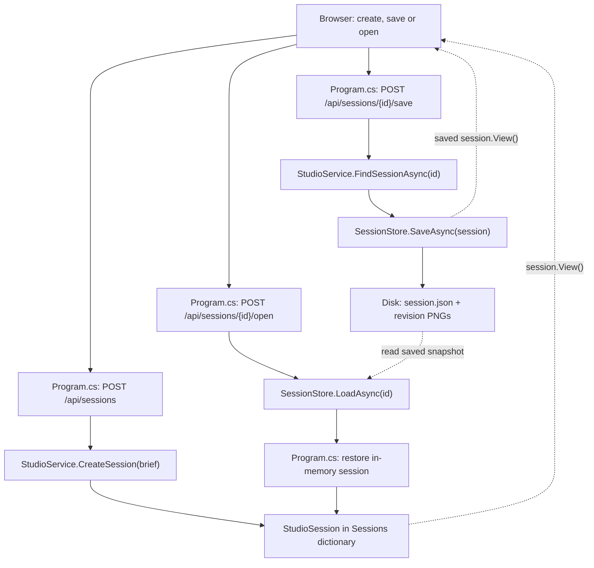
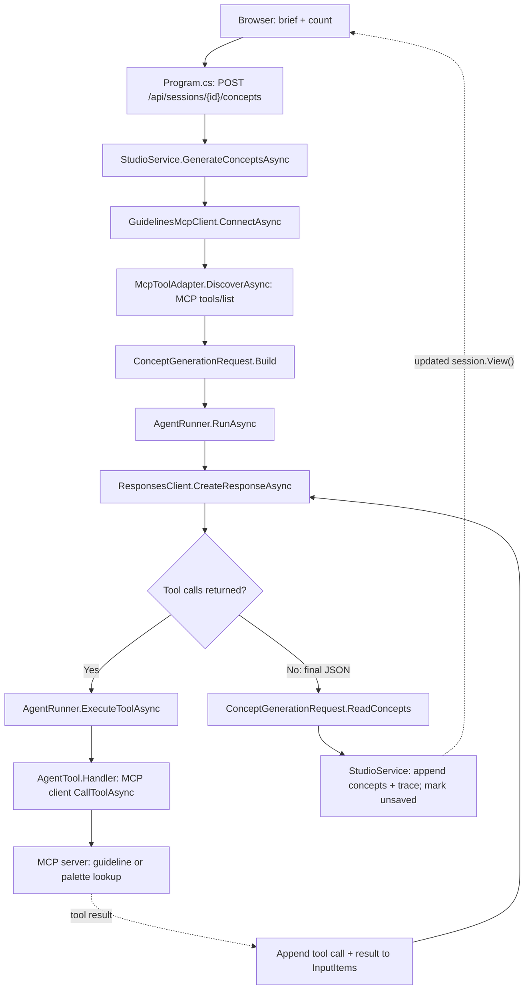
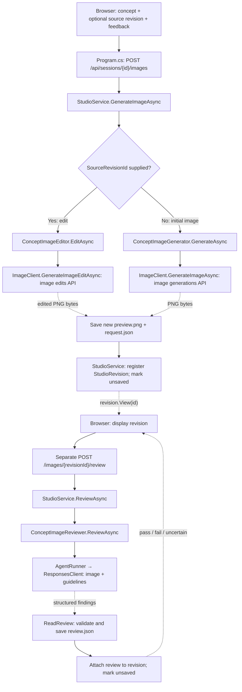

# Concept Studio — interview one-pager

Updated 10 October 2026. Living notes from our C# LLM integration project. Add concrete lessons as we encounter them; keep this page concise and put longer explanations in the README.

## What I built

A local ASP.NET Core web app with a JavaScript UI and a console host sharing `ConceptStudio.Core`. Designers can create/save/reopen sessions, generate 1–3 concepts, retrieve fictional guidelines and colour palettes through MCP, visualize concepts, edit selected image revisions, and get advisory visual reviews. It has not been deployed to production or validated with real designers.

## Main program flows

The browser calls routes in `ConceptStudio.Web/Program.cs`. `StudioService` orchestrates model operations; `SessionStore` handles persistence; shared model integrations live in `ConceptStudio.Core`.

The call graphs below show the main successful paths. Solid arrows show calls or workflow steps; dotted arrows show returned data. Session gates, validation and error handling are described in the accompanying notes.

### 1. Create, save or load a session

**Create:** browser → `POST /api/sessions` → `StudioService.CreateSession` → new `StudioSession` in the in-memory dictionary → session view returned to browser. No model call or API key is needed.

**Save:** browser → `POST /api/sessions/{id}/save` → validate name/brief/selected revision → acquire session gate → `SessionStore.SaveAsync` → copy revision PNGs into the session folder → write a versioned JSON snapshot → replace `session.json` → mark saved. Saving is explicit; unsaved changes can be lost on restart.

**Load:** browser → `POST /api/sessions/{id}/open` → `SessionStore.LoadAsync` → validate snapshot and reconstruct concepts, traces, revisions and selection → restore in-memory state → render browser view. Opening a save restores its saved state, replacing current in-memory changes for that session. Ordinary `GET /api/sessions/{id}` uses `FindSessionAsync`: memory first, disk if absent.

### 2. Generate concepts and an initial image

The initial image follows the separate image path below, choosing the generation branch rather than editing.

**Concepts:** browser brief + count → `POST /api/sessions/{id}/concepts` → validate inputs/acquire gate → `StudioService.GenerateConceptsAsync` → connect MCP/discover tools → `ConceptGenerationRequest.Build` → `AgentRunner.RunAsync` → tool loop → strict JSON → `ReadConcepts` validation → append concepts and trace → return updated session.

Earlier concepts remain available. Each new concept records its source brief from our request, rather than relying on the model to reproduce it. Generating again starts a fresh agent conversation; earlier session concepts are not automatically supplied to it.

**Initial image:** choose concept → `POST /api/sessions/{id}/images` with no source revision → `StudioService.GenerateImageAsync` → `ConceptImageGenerator.GenerateAsync` → save PNG/request record → register `StudioRevision` → browser displays image. The current prompt requests three-quarter, front and rear views in one image.

### 3. Edit an image and review the result

The review branch shows a fresh review with guidelines. Cached reviews return directly; an empty guideline list skips the model call.

Select a revision + enter feedback → `POST /api/sessions/{id}/images` with `ConceptIndex`, `SourceRevisionId`, `Feedback` → validate source belongs to concept/acquire gate → `StudioService.GenerateImageAsync` → `ConceptImageEditor.EditAsync` → upload selected PNG + feedback + guidelines → save new PNG/request record → create revision linked to its source → browser displays result.

The selected source can be an earlier revision, allowing exploration to branch. Existing images remain available; the session becomes unsaved and needs an explicit save to persist the new revision.

After generation or editing, the browser separately calls `/images/{revisionId}/review` → `StudioService.ReviewAsync` → `ConceptImageReviewer` → image + numbered guidelines sent to the text/vision model → structured `pass`/`fail`/`uncertain` findings → validate one finding per guideline → attach review to revision. Review failure leaves the image usable. Existing reviews are reused; no guidelines means no paid review call.

## The agent loop

**Brief + instructions + schemas → model → tool request → C# executes tool → result sent back → model → final concepts.** Repeat when more tools are requested.

- The model requests a tool by returning its name, arguments and a call ID. Our runtime performs the execution. The model doesn't execute our C# code.
- The model derives arguments such as `theme: "underwater"` from the brief and tool definition. Our handler parses and validates those arguments.
- `AgentRunner` dispatches registered handlers and returns each result with the matching call ID. Unknown tools and malformed JSON produce tool errors.
- Our loop allows four model requests and shares a 60-second timeout. Check completion, refusal and empty output; total token usage includes every round.
- An agent loop is useful when the model needs to choose tools. Our image generation and editing use a fixed workflow driven by the user.

## MCP: Model Context Protocol

MCP standardizes how a client discovers and invokes tools exposed by a server. It does not make the model execute them.

**Our app → discover MCP tools → send definitions to model → receive tool request → call MCP server → return result to model.**

`GuidelinesMcpClient` starts a separate local server over stdio. `McpToolAdapter` discovers all tools and adapts their schemas and handlers to our agent loop. `DesignGuidelinesTools` performs the actual lookup. Stdout carries protocol messages; server logs go to stderr. The server does not inherit our OpenAI API key.

The `guidelines` property is ordinary JSON data. Instructions, tool descriptions and the result's content help the model interpret it; the property name isn't a special SDK command. Guidelines support underwater and adventure. A second tool, `get_colour_palette`, supplies named palettes and hex codes. The model chooses tools from their descriptions; requested palettes override conflicting guideline colours according to our instructions.

## Memory and context

The same API key or client instance does not automatically give calls shared conversation memory. In this app, each request supplies the context needed for that response.

| Flow | Context we supply |
| --- | --- |
| Text agent | Instructions, brief, accumulated model output, tool calls and tool results. |
| Image generation | Selected concept's description, image prompt and reported applied guidelines. |
| Image edit | Selected source revision's image bytes, current feedback and guidelines. Earlier feedback isn't resent. |
| Visual review | Selected image bytes and numbered guidelines; no tools or previous conversation. |

The selected image carries previous edits visually, but cannot preserve an instruction that isn't visible. Saved sessions provide application persistence, not automatic model memory. Persistent preferences must be included in subsequent model requests to influence them. Conversation context does not train or update the model's weights.

## Structured output and correctness

The output schema constrains generation **before** `GetOutputText()` and C# deserialization. Adding an instruction alone didn't add `appliedGuidelines`: we also needed to update the strict schema and C# record.

Schema conformance establishes response shape, not factual or visual correctness. We saw three windows despite asking for exactly two. Model-reported applied guidelines are not proof of compliance or an authoritative copy of the tool result.

## Image feedback and engineering lessons

Edits upload an existing image with feedback to the image edits endpoint. The image supplies current appearance; feedback specifies the change; guidelines supply constraints. We ask it to preserve unrelated details, then inspect the result.

Each revision is saved separately with its source path, prompt, feedback and settings. Parent revision IDs record the editing lineage. A vision model can flag possible violations, but its review is advisory and can also be wrong. Image calls have fresh three-minute timeouts and no automatic retries: a timeout doesn't prove the provider did no work. The web host keeps API credentials on the server. A per-session semaphore prevents overlapping mutations in the main operation routes, and session snapshots are replaced only after image copies and JSON writes complete. Mock HTTP checks verify uploaded bytes and request handling; real model runs are needed to evaluate visual quality.

## Interview takeaway

“I learned to separate model reasoning from runtime execution, manage context explicitly, and distinguish a valid API response from a useful design result. The window-count failure showed why designer review and iteration belong in the product.”

Production next steps to discuss: designer usability testing, representative quality evaluations, access controls, observability, cost limits and deployment. Training on existing designs would not by itself guarantee physical buildability; that would require separate domain validation.
